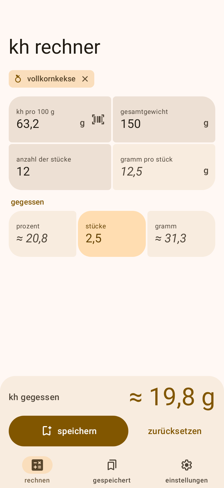
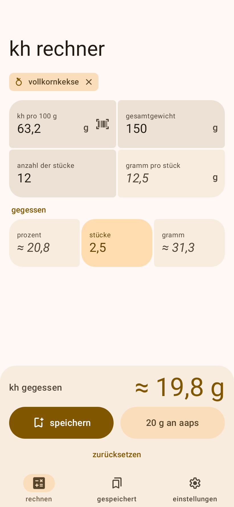
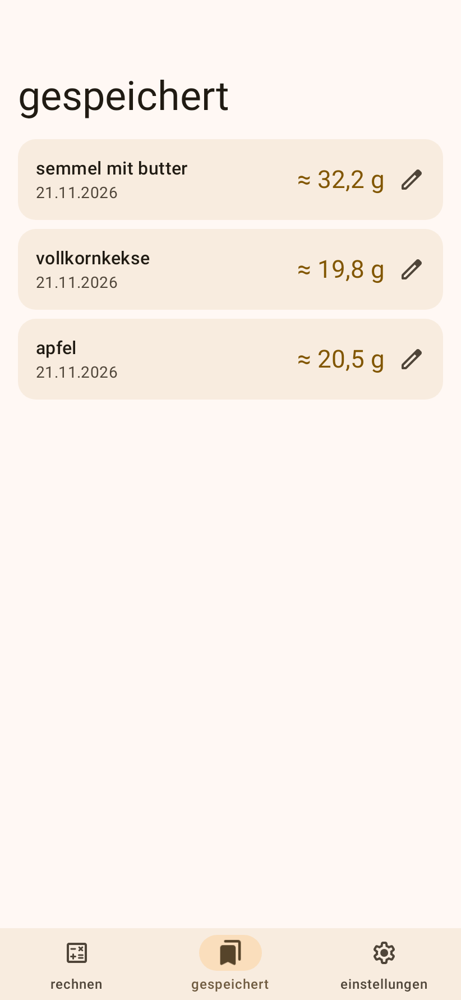
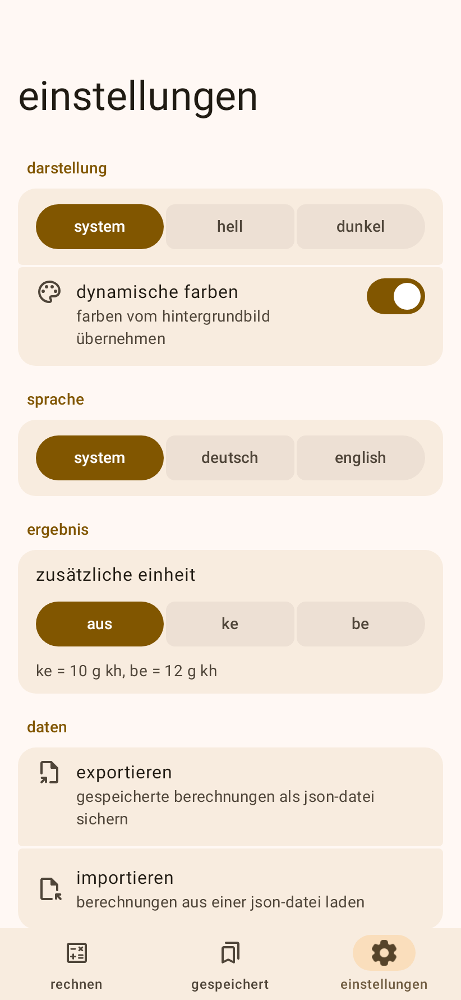

# KH Rechner

Carb calculator for Android. Enter what the label says and how much you ate, 
and it tells you the grams of carbohydrates.

**[Download the APK](https://github.com/Brokoli5191/kh-rechner/releases/latest)** · [Build it yourself](docs/BUILDING.md)

## What it does

Take a pack of wholegrain biscuits: 63.2 g of carbs per 100 g, 150 g in the pack, 12 biscuits. You
ate two and a half. That is 31.25 g of biscuit and 19.75 g of carbohydrates, and nobody wants to
work that out at the table. KH Rechner does it while you type.

"KH" is short for Kohlenhydrate, German for carbohydrates. The app speaks German and English.

You fill in what you know:

- carbs per 100 g, typed from the label or scanned from the barcode
- total weight and number of pieces, if the food comes in pieces
- how much you ate, as a percentage, in pieces or in grams

The three "eaten" fields are linked. Whichever you edited last counts, and the other two are
calculated and shown in italics. If all you have is a weight, carbs per 100 g and grams eaten are
enough.

## Features

- All seven fields fit on one screen, with the keyboard open too.
- `≈` marks a number that was rounded for display. Exact values are shown without it.
- The barcode scan looks the product up on [Open Food Facts](https://world.openfoodfacts.org) and
  fills in the carbs. A product you scanned once works offline afterwards.
- Save a calculation under a name and load it later with all its inputs.
- Export everything to a JSON file and import it on another phone.
- A second result line in KE (10 g) or BE (12 g), if you count in those.
- Colours follow your wallpaper (Material You), in light and dark.

<table>
  <tr>
    <td align="center"></td>
    <td align="center"></td>
    <td align="center"></td>
  </tr>
  <tr>
    <td align="center">Saved calculations</td>
    <td align="center">Settings</td>
    <td align="center">Material You colours</td>
  </tr>
</table>

The pictures are rendered from the app by its own tests. The warm brown ones show the built-in
colours, which you only see if you switch dynamic colours off.

## Install

1. Download `kh-rechner-x.y.z.apk` from the
   [latest release](https://github.com/Brokoli5191/kh-rechner/releases/latest).
2. Open the file on your phone. Android asks once whether your browser or file manager may install
   apps.
3. To update later, install the newer APK over the old one. Your saved calculations stay.

The app needs Android 13 or newer. The barcode scanner needs Google Play services. On a phone
without them the scan button is hidden and the rest works.

## Sending carbs to AAPS

If [AndroidAPS](https://github.com/nightscout/AndroidAPS) is on the phone, a button next to
"speichern" shows the result in whole grams, for example "20 g an aaps". Tapping it copies that
number and opens AAPS. You paste it into the carbs dialog there and confirm as usual.

It stops there on purpose. AAPS has no way for another app to pre-fill that dialog, and the
interfaces that do accept carbs book them without asking you. A number on the clipboard cannot
dose anything by itself.

## What leaves your phone

A barcode scan sends the barcode number to Open Food Facts to look the product up. The app sends
nothing else and has no account, no analytics and no ads. Saved calculations stay on the device,
and in Android's own backup if you have that switched on.

## Before you rely on it

KH Rechner is a calculator, not a medical device. Labels can be wrong, Open Food Facts is filled
in by volunteers, and typos happen. Look at the number before you dose insulin on it.

## For developers

Kotlin, Jetpack Compose with Material 3 Expressive, Navigation 3 and DataStore, in a single module
without a DI framework. The calculation is plain Kotlin with exact fractions and has its own
tests. The UI tests run on the JVM and also produce the screenshots on this page.

How to build, test and publish a release is in [docs/BUILDING.md](docs/BUILDING.md).

## Licence and credits

The code is in the public domain, see [LICENSE](LICENSE). Product data comes from
[Open Food Facts](https://world.openfoodfacts.org) under the
[Open Database License](https://opendatacommons.org/licenses/odbl/1-0/). The icons are
[Material Symbols](https://fonts.google.com/icons) under the Apache License 2.0.
