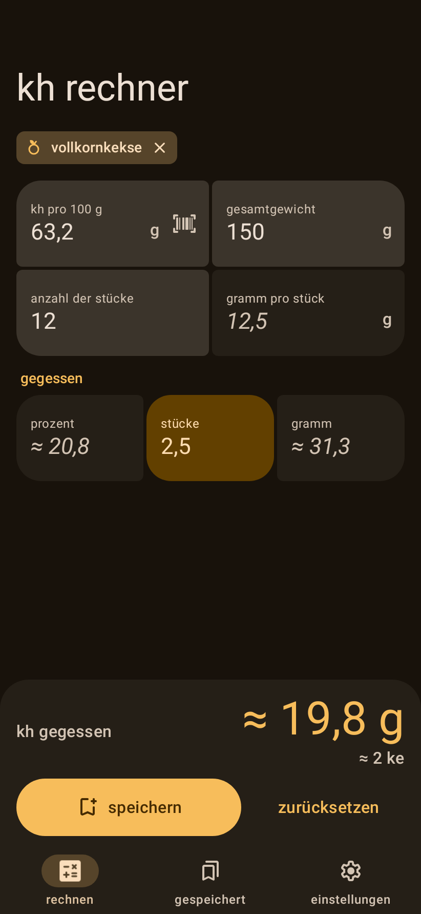
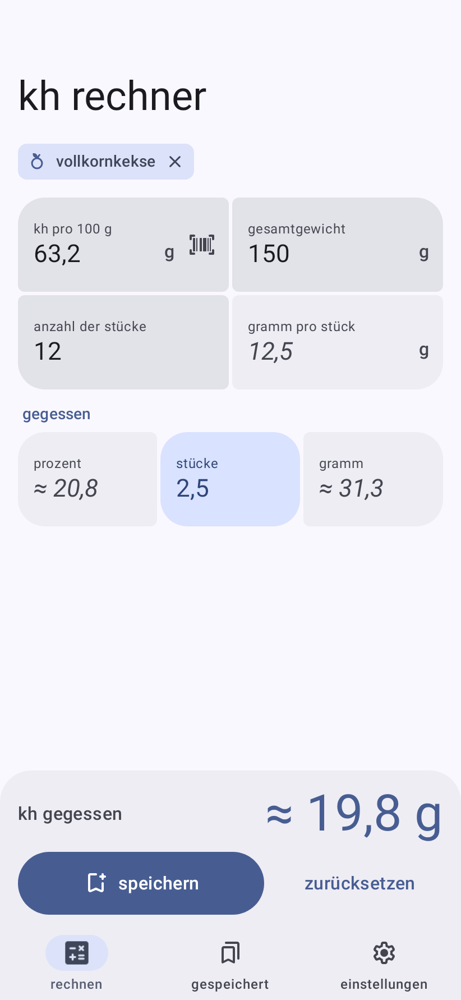

# KH Rechner

[](https://github.com/Brokoli5191/kh-rechner/actions/workflows/ci.yml)
[](https://github.com/Brokoli5191/kh-rechner/releases/latest)
-3ddc84)

Android app that works out how many grams of carbohydrates you ate. You enter the carbs per 100 g
from the label and how much of the food you had, as a percentage, a number of pieces or in grams.
The app derives the other two and shows the result. German by default, English as second language.

| Calculator | Dark, with KE | Material You | Saved | Settings |
|---|---|---|---|---|
|  |  |  |  |  |

The screenshots are rendered from the real app by a unit test, not taken on a phone. The first
two use the built-in fallback colours. On a device the app follows your wallpaper (Material You)
unless you switch that off.

## What it does

- All seven fields fit on one screen without scrolling. The three "eaten" fields are linked: the
  one you edited last is the source, the other two are computed and shown in italics.
- `≈` only appears in front of a number that really was rounded for display.
- Barcode scan fills in the carbs per 100 g from [Open Food Facts](https://world.openfoodfacts.org).
  Scanned products are cached, so a repeat scan works offline.
- Save calculations, load them back with every input intact, rename, duplicate, delete with undo.
- Export and import as JSON, with merge or replace.
- Optional second result line in KE (10 g) or BE (12 g).
- Light, dark or system theme, dynamic colour, per-app language through the Android system setting.

This is a calculator, not a medical device. Check the numbers before you dose insulin on them.

## Install

Download the APK from the [latest release](https://github.com/Brokoli5191/kh-rechner/releases/latest)
and open it on a phone running Android 13 or newer. Barcode scanning needs Google Play services.
Without them the scan button is hidden and everything else works.

## Build

You need JDK 17 or newer and the Android SDK. The Gradle wrapper fetches the rest, including the
Android 17 (API 37.1) platform the build compiles against.

```sh
./gradlew assembleDebug          # app/build/outputs/apk/debug/app-debug.apk
./gradlew testDebugUnitTest      # unit tests and UI tests on the JVM (Robolectric)
./gradlew lintDebug
./gradlew testDebugUnitTest -Pscreenshots   # re-render docs/screenshots
```

A release build without signing variables produces an unsigned APK:

```sh
./gradlew assembleRelease
```

## Signing and releases

Pushing a tag `v1.2.3` runs `.github/workflows/release.yml`. It builds a signed release APK with
version name `1.2.3`, version code `10203`, and attaches it to a GitHub Release with generated notes.

Create a keystore once and keep it somewhere safe. An update only installs over an older version
if it is signed with the same key.

```sh
keytool -genkeypair -v -keystore release.jks -alias khrechner \
  -keyalg RSA -keysize 4096 -validity 10000
base64 -w0 release.jks        # macOS: base64 -i release.jks
```

Add four repository secrets under Settings → Secrets and variables → Actions:

| Secret | Value |
|---|---|
| `KEYSTORE_BASE64` | output of the `base64` command |
| `KEYSTORE_PASSWORD` | keystore password |
| `KEY_ALIAS` | `khrechner`, or the alias you chose |
| `KEY_PASSWORD` | key password |

To sign locally, set `KH_KEYSTORE_FILE`, `KH_KEYSTORE_PASSWORD`, `KH_KEY_ALIAS` and
`KH_KEY_PASSWORD` in the environment before `./gradlew assembleRelease`. The keystore and
`local.properties` are in `.gitignore`.

## Project layout

One module, `:app`, package `app.brokoli5191.khrechner`:

- `domain/`: the calculation, pure Kotlin. It uses exact fractions, which is how it knows
  whether a displayed value was rounded.
- `data/`: DataStore with kotlinx.serialization, export and import, the Open Food Facts client,
  the barcode scanner wrapper.
- `ui/`: Compose, one package per screen, Material 3 Expressive, Navigation 3.

The export file is JSON with a `schemaVersion` field (currently `1`). It holds the saved
calculations and the product cache. Files from a newer schema version are refused with a message.

## Not included: sending carbs to AAPS

The plan was to hand the result to AndroidAPS as a pre-filled entry that you confirm there. Stock
AAPS has no entry point for that. Its exported receiver takes glucose data and SMS, and the source
of 3.2.0.4, 3.3.2.1, 3.4.2.6 and 4.0.0 has nothing in it that takes carbs. The only local way to
pass carbs in is the Garmin HTTP endpoint, and that one writes them straight to the database
without a confirmation. That is the opposite of what was wanted, so the button is not there.

## Licence

Public domain, see [LICENSE](LICENSE). The icons are
[Material Symbols](https://fonts.google.com/icons) under the Apache License 2.0.
